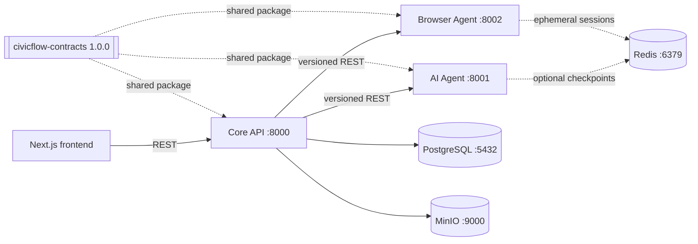

# CivicFlow backend architecture

The backend is split into three independently packaged FastAPI services. They share only `civicflow-contracts`; service implementations communicate over HTTP. Core is the sole authority for application status. AI output is a proposal, and browser events are evidence for Core to evaluate.

Current implementation status: Core API application, auth and document records are in-memory development scaffolds. PostgreSQL, Alembic, durable session/event processing, signed browser callbacks, real LangGraph nodes, and the Playwright worker lifecycle still need implementation before production or multi-user use. The AI and browser endpoints label their current mock mode explicitly.
