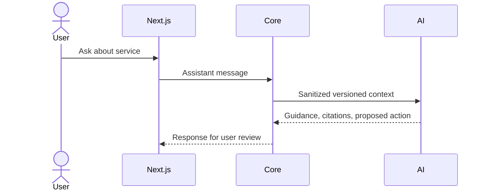

# Integration guide

1. Merge the frozen contracts package into the integration branch first.
2. Install the local contract wheel in each service environment (`uv sync --project backend/services/<service>` resolves the workspace package path in the project configuration).
3. Start services separately using the commands in member guides, or use `docker compose -f backend/infrastructure/docker-compose.yml up --build` from the repository root.
4. Configure `AI_AGENT_URL`, `BROWSER_AGENT_URL`, `DATABASE_URL`, `REDIS_URL`, and `OBJECT_STORAGE_URL` through environment variables. `USE_MOCK_AI` and `USE_MOCK_BROWSER` preserve Core business code while switching adapters.
5. Run contract and service tests in each package. Integration scenarios must use local mock portals only.
6. Merge `feature/core-backend-member1`, `feature/ai-agent-member2`, and `feature/browser-agent-member3` into `integration/backend-main`; resolve contract drift before service code.

Run tests from the repository root:

```powershell
$env:PYTHONPATH="backend/contracts/civicflow_contracts"
python -m pytest backend/contracts/tests -q
$env:PYTHONPATH="backend/contracts/civicflow_contracts;backend/services/ai_agent"
python -m pytest backend/services/ai_agent/tests -q
$env:PYTHONPATH="backend/contracts/civicflow_contracts;backend/services/browser_agent"
python -m pytest backend/services/browser_agent/tests -q
$env:PYTHONPATH="backend/contracts/civicflow_contracts;backend/services/core_api"
python -m pytest backend/services/core_api/tests -q
```



```mermaid
sequenceDiagram
  actor User
  participant Core
  participant Browser
  User->>Core: Request portal preparation
  Core->>Browser: Create approved-domain session
  Browser-->>Core: Session and stream details
  Browser-->>Core: Inspection events (signed in production)
  Core->>Browser: Pause / take control
  User->>Browser: Enter secrets directly in visible page
  Core->>Browser: Return control; safe non-sensitive actions
  Browser-->>Core: Prepared form evidence
  Core->>User: Request explicit application-specific approval
  User->>Core: Approve
  Core->>Browser: Start authorized submission
  Browser-->>Core: Verified evidence or uncertain outcome
  Core->>Core: Validate evidence and record status/activity
```

The diagrams describe the target integration protocol. Signed callbacks, database-backed event audit, approval persistence and verified portal evidence still need implementation in the current scaffold.
