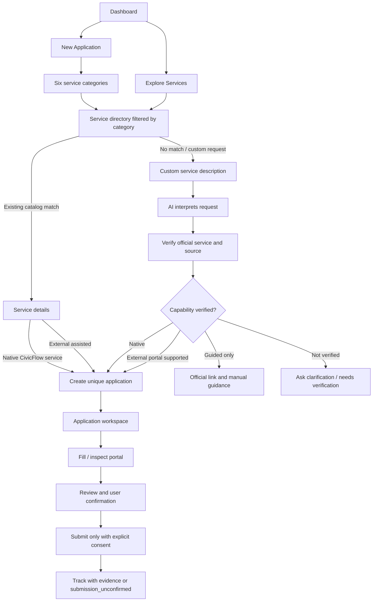
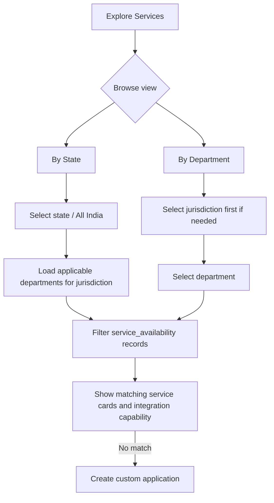
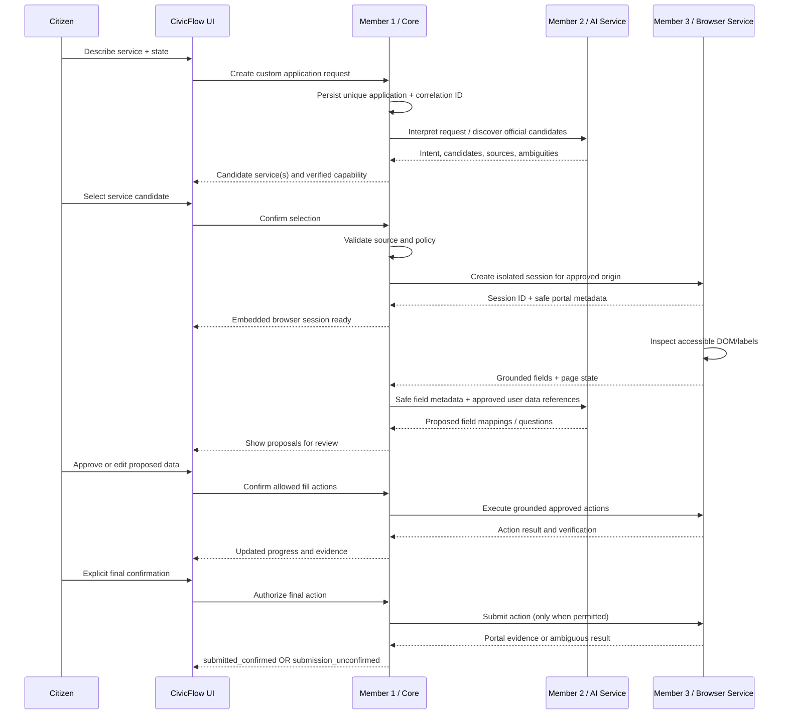

# CivicFlow — Product Flow Diagrams

## 1. Main navigation and application paths

## 2. By State and By Department

## 3. Custom application and three-member orchestration

## 4. Key rule

AI does not directly control Playwright. Browser does not decide user authorization. Core coordinates and enforces the contracts/policy. The citizen remains in control.
